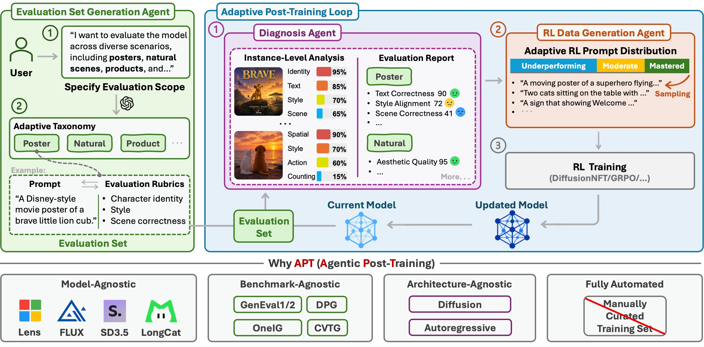

<div align="center">

<h1 align="center">
  
</h1>

<p align="center" style="font-size: 1.1em;">
  Let the model’s feedback shape what it learns next.
</p>

<div align="center">
  <a href="https://github.com/siruizhang30">Sirui Zhang</a><sup>1,2*</sup>&nbsp;&nbsp;
  <a href="https://www.microsoft.com/en-us/research/people/fawe/">Fangyun Wei</a><sup>2</sup>&nbsp;&nbsp;
  <a href="https://www.microsoft.com/en-us/research/people/doch/">Dong Chen</a><sup>2</sup>&nbsp;&nbsp;
  <a href="https://github.com/ZhaoJingjing713">Jinjing Zhao</a><sup>3</sup><br>
  <a href="https://github.com/snowflakewang">Yitong Wang</a><sup>4</sup>&nbsp;&nbsp;
  <a href="https://unoc-727.github.io/">Yunuo Chen</a><sup>5</sup>&nbsp;&nbsp;
  <a href="https://www.microsoft.com/en-us/research/people/bainguo/">Baining Guo</a><sup>2</sup>&nbsp;&nbsp;
  <a href="https://scholar.google.com/citations?user=gDnBC1gAAAAJ&amp;hl=en">Zheng-Jun Zha</a><sup>1</sup><sup>&dagger;</sup>
</div>

<p align="center" style="font-size: 0.9em;">
  <br>
  <sup>1</sup>University of Science and Technology of China&nbsp;&nbsp;
  <sup>2</sup>Microsoft Research Asia<br>
  <sup>3</sup>University of Sydney&nbsp;&nbsp;
  <sup>4</sup>Fudan University&nbsp;&nbsp;
  <sup>5</sup>Shanghai Jiao Tong University
  <br><br>
  <small><sup>*</sup>Work done during internship at MSRA.</small>
  <small><sup>&dagger;</sup>Corresponding Author</small>
</p>

<p align="center">
  <a href="https://arxiv.org/abs/2610.18097"></a>
  <a href="https://siruizhang30.github.io/APT-page/"></a>
  <a href="https://github.com/siruizhang30/APT"></a>
</p>

</div>

---

## 📖 Abstract

Post-training is crucial for improving text-to-image models, yet existing pipelines typically rely on manually curated training data and fixed training distributions.
We introduce APT (Agentic Post-Training), a fully automated framework that adaptively post-trains a base model according to its evolving capability profile.
APT coordinates three agents to construct evaluation sets from user requirements, diagnose model-specific strengths and failure modes, and generate reinforcement learning data with an adaptive prompt distribution that emphasizes underperforming capabilities.
By repeatedly evaluating, diagnosing, and updating the generator, APT lets the current model's behavior shape its next training tasks, forming a feedback loop inspired by recursive self-improvement.
For general-purpose settings without user-specified evaluation scenarios, we further develop an evaluation harness that enables broad and diverse evaluation set generation.
Experiments across multiple base models, benchmarks, and generation architectures demonstrate that APT is model-agnostic, benchmark-agnostic, architecture-agnostic, and fully automated.

## 🔄 Method

<div align="center">
  
</div>

APT coordinates three agents to turn model feedback into an adaptive post-training curriculum:

1. **Evaluation Set Generation Agent** constructs a fixed set of prompt–rubric pairs from a user-specified scope or a general-purpose evaluation harness.
2. **Diagnosis Agent** evaluates images generated by the current model against prompt-specific rubrics, producing a report of its strengths and failure modes.
3. **RL Data Generation Agent** uses this report to generate new training prompts, prioritizing weak capabilities while retaining coverage of moderate and mastered capabilities.

The model is updated through reinforcement learning and then diagnosed again, so its evolving capabilities continually shape the next round of training data.

## 📊 Results

### Main Results

**Table 1.** Comparison with the original base models and a handcrafted RL post-training baseline. APT achieves the best five-benchmark average across all four models using the same agentic workflow.

| Model | Setting | GenEval ↑ | OneIG-EN ↑ | GenEval2 ↑ | DPG ↑ | CVTG-2K ↑ | Average ↑ |
| :--- | :--- | ---: | ---: | ---: | ---: | ---: | ---: |
| Lens | Base Model | 0.702 | 0.521 | 29.06 | 85.93 | 0.480 | 57.06 |
| | w/ Handcrafted RL Set | 0.815 | 0.518 | 46.35 | 87.60 | 0.758 | 68.61 |
| | **w/ APT** | 0.859 | 0.523 | 50.73 | 87.88 | 0.795 | **71.26** |
| SD3.5-Medium | Base Model | 0.684 | 0.408 | 17.63 | 83.67 | 0.312 | 48.34 |
| | w/ Handcrafted RL Set | 0.722 | 0.399 | 27.64 | 86.54 | 0.534 | 55.94 |
| | **w/ APT** | 0.763 | 0.404 | 29.50 | 86.50 | 0.569 | **57.92** |
| FLUX.1 [dev] | Base Model | 0.660 | 0.388 | 22.23 | 82.54 | 0.260 | 47.11 |
| | w/ Handcrafted RL Set | 0.721 | 0.435 | 29.47 | 85.53 | 0.310 | 52.32 |
| | **w/ APT** | 0.751 | 0.459 | 31.01 | 85.75 | 0.513 | **57.81** |
| LongCat-Image | Base Model | 0.727 | 0.500 | 28.60 | 85.71 | 0.426 | 55.92 |
| | w/ Handcrafted RL Set | 0.780 | 0.503 | 31.14 | 87.80 | 0.730 | 64.05 |
| | **w/ APT** | 0.832 | 0.510 | 34.43 | 87.89 | 0.821 | **67.72** |

GenEval and DPG report overall scores; OneIG-EN reports its average; GenEval2 reports Soft-TIFA<sub>GM</sub>; CVTG-2K reports word accuracy. **Average** rescales GenEval, OneIG-EN, and CVTG-2K to 0–100 before averaging all five scores. Bold averages indicate the best setting for each model.

### Transfer Experiments

**Table 2. APT captures model-specific training distributions.** Rows indicate the **target model** being post-trained; columns indicate the **source model** for which APT generated the RL training data. Diagonal entries are the standard APT setting, where data is adaptively generated for the target model itself. Off-diagonal entries reuse data generated for another model. Bold values indicate the best score in each row.

**(a) GenEval ↑**

| Target / Source | Lens | SD3.5-Medium | FLUX.1 [dev] | LongCat-Image |
| :--- | ---: | ---: | ---: | ---: |
| Lens | **0.851** | 0.833 | 0.846 | 0.798 |
| SD3.5-Medium | 0.736 | **0.743** | 0.742 | 0.722 |
| FLUX.1 [dev] | 0.679 | 0.726 | **0.751** | 0.729 |
| LongCat-Image | 0.823 | 0.786 | 0.827 | **0.828** |

**(b) OneIG-EN ↑**

| Target / Source | Lens | SD3.5-Medium | FLUX.1 [dev] | LongCat-Image |
| :--- | ---: | ---: | ---: | ---: |
| Lens | **0.523** | 0.522 | 0.517 | 0.520 |
| SD3.5-Medium | 0.404 | 0.404 | **0.405** | 0.395 |
| FLUX.1 [dev] | 0.436 | 0.443 | **0.459** | 0.440 |
| LongCat-Image | **0.509** | 0.496 | 0.508 | 0.506 |

**(c) GenEval2 ↑**

| Target / Source | Lens | SD3.5-Medium | FLUX.1 [dev] | LongCat-Image |
| :--- | ---: | ---: | ---: | ---: |
| Lens | **46.80** | 44.59 | 46.35 | 44.98 |
| SD3.5-Medium | 23.61 | **27.58** | 23.74 | 22.65 |
| FLUX.1 [dev] | 30.06 | 28.69 | **31.01** | 30.02 |
| LongCat-Image | 34.91 | 37.37 | 34.90 | **37.80** |

**(d) Average over three benchmarks ↑**

| Target / Source | Lens | SD3.5-Medium | FLUX.1 [dev] | LongCat-Image |
| :--- | ---: | ---: | ---: | ---: |
| Lens | **61.40** | 60.03 | 60.88 | 58.93 |
| SD3.5-Medium | 45.87 | **47.43** | 46.15 | 44.78 |
| FLUX.1 [dev] | 47.19 | 48.53 | **50.67** | 48.97 |
| LongCat-Image | 56.04 | 55.19 | 56.13 | **57.07** |

The average uses **GenEval, OneIG-EN, and GenEval2**, with GenEval and OneIG-EN rescaled to 0–100. The diagonal setting achieves the **best average for every target model**, supporting the benefit of adapting training data to each model's evolving capabilities.

## ✉️ Contact

For questions about APT, please contact [zsr200901@mail.ustc.edu.cn](mailto:zsr200901@mail.ustc.edu.cn).

## 🔮 Citation

```bibtex
@misc{zhang2026aptfeedbackdrivenagenticposttraining,
      title={APT: Feedback-Driven Agentic Post-Training for Text-to-Image Generation}, 
      author={Sirui Zhang and Fangyun Wei and Dong Chen and Jinjing Zhao and Yitong Wang and Yunuo Chen and Baining Guo and Zheng-Jun Zha},
      year={2026},
      eprint={2610.18097},
      archivePrefix={arXiv},
      primaryClass={cs.CV},
      url={https://arxiv.org/abs/2610.18097}, 
}
```
